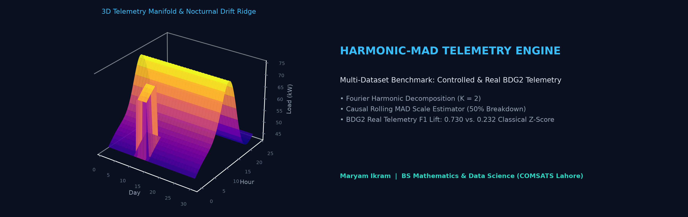

<div align="center">



# Mitigating Statistical Masking in Smart Meter Telemetry via Fourier-Harmonic Decomposition and Rolling MAD

[](https://www.linkedin.com/in/maryamikram)
[](https://orcid.org/0009-0008-6093-2789)
[](#)
[](Harmonic_MAD_Energy_Study.pdf)

**A semi-parametric mathematical framework combining truncated Fourier harmonic regression with a causal rolling Median Absolute Deviation (MAD) estimator to eliminate variance-induced masking in building energy telemetry.**

</div>

---

### 1. Research Motivation & Mathematical Formulation

Conventional sliding-window *Z*-score detectors fail during multi-day operational faults (such as unscheduled nocturnal HVAC operation) because sustained outliers inflate local sample variance—a failure mode known in robust statistics as **statistical masking** (0% breakdown point).

To decouple deterministic periodicity from stochastic anomalies, we formulate a two-stage pipeline over half-hourly load telemetry ($P = 48$ intervals/day):

$$\hat{b}_t = \beta_0 + \sum_{k=1}^{K} \left[ \alpha_k \sin\left(\frac{2\pi k t}{P}\right) + \gamma_k \cos\left(\frac{2\pi k t}{P}\right) \right] + \delta \, \mathbb{I}_{\text{wknd}}(t)$$

Detrended residuals $r_t = x_t - \hat{b}_t$ are standardized via a causal sliding-window ($W = 48$) **Median Absolute Deviation** estimator achieving the optimal **50% breakdown point**:

$$Z_{\text{MAD}, t} = \frac{r_t - \tilde{r}_t}{1.4826 \cdot \operatorname{median}_{j \in \mathcal{W}_t}\left(|r_j - \tilde{r}_t|\right) + \epsilon}$$

---

### 2. System Architecture

```mermaid
flowchart LR
    A[("Half-Hourly Telemetry<br/>(N = 1,440, Δt = 0.5h)")] --> B["Stage 1: Fourier Harmonic<br/>Regression (K = 2)"]
    B --> C["Detrended Residuals<br/>r_t = x_t - b_hat_t"]
    C --> D["Stage 2: Causal Rolling MAD<br/>(W = 48, 50% Breakdown)"]
    D --> E{"|Z_MAD| > 2.8?"}
    E -->|Yes| F["Flagged Anomaly<br/>(Nocturnal Drift / Spike)"]
    E -->|No| G["Normal Baseline Regime"]

    style A fill:#0f172a,stroke:#38bdf8,color:#f8fafc
    style B fill:#0f172a,stroke:#22c55e,color:#f8fafc
    style C fill:#0f172a,stroke:#a855f7,color:#f8fafc
    style D fill:#0f172a,stroke:#fbbf24,color:#f8fafc
    style F fill:#450a0a,stroke:#f43f5e,color:#fecdd3
    style G fill:#052e16,stroke:#22c55e,color:#bbf7d0
